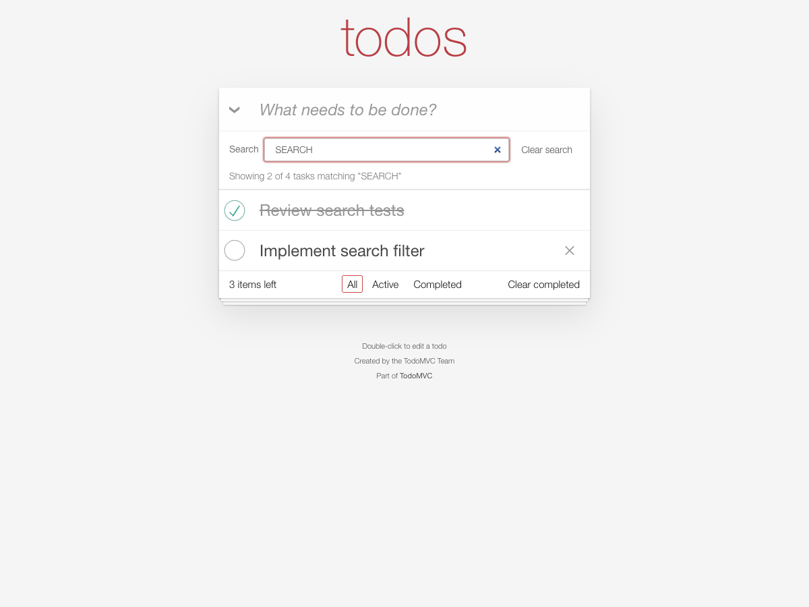

# TodoMVC with live title search

A student adaptation of [TodoMVC](https://github.com/tastejs/todomvc/tree/master/examples/javascript-es6). See [upstream attribution](UPSTREAM.md) and [MIT license](LICENSE).



TodoMVC: JavaScript Es6 with Webpack

## Description

This application uses JavaScript with ES6 language features to implement a todo application.

JavaScript (JS) is a lightweight, interpreted, or just-in-time compiled programming language with first-class functions. While it is most well-known as the scripting language for Web pages, many non-browser environments also use it..

[JavaScript - developer.mozilla.org](http://developer.mozilla.org/en-US/docs/JavaScript)

In addition, this application also relies on [Webpack](https://webpack.js.org/) to generate a build. At its core, webpack is a static module bundler for modern JavaScript applications. When webpack processes your application, it internally builds a dependency graph from one or more entry points and then combines every module your project needs into one or more bundles, which are static assets to serve your content from.

## Implementation Details

This implementation uses an explicit MVC pattern, with a clear file structure to reflect the architecture. The storage solution uses an in-memory data object that implements a simple array to hold the todos.

## Search

On top of the standard All / Active / Completed filters, this example adds a live, case-insensitive substring search on todo titles. The search toolbar sits between the "What needs to be done?" field and the todo list, and contains a visible `Search` label, the search box, a `Clear search` button and a status line.

Behavior:

- **Live matching.** Results update on every keystroke. A todo matches when its title contains the query as a substring, ignoring case.
- **Trimmed query.** Leading and trailing whitespace is ignored when matching, so `"  milk "` matches the same todos as `"milk"`.
- **Composes with the status filter.** The query is applied on top of the active route, so `#/active` plus the query `milk` shows only active todos whose title contains "milk".
- **Preserved across status switches.** Switching between All, Active and Completed keeps the query and re-applies it. The query is in-memory only, so a page reload clears it (as it clears the todos).
- **Result count.** While searching, the status line reads `Showing 2 of 5 tasks matching "milk"`, where the total is the number of todos in the current status filter.
- **No matches.** When nothing matches, the status line reads `No tasks match "milk"` and the list is empty. The status line is a `role="status"` / `aria-live="polite"` region referenced by the search box via `aria-describedby`, so screen readers announce the result; its text is written with `textContent`, so a query is echoed back verbatim and is never interpreted as markup.
- **Clearing.** The `Clear search` button empties the query, restores the full list for the active status filter and returns focus to the search box. Pressing `Escape` while the search box is focused does the same. The button is disabled while the query is empty.
- **Stays in sync.** Adding, editing, completing and deleting a todo re-applies the query, including when an edit makes a previously matching title stop matching (the item then disappears from the results).
- **Counts are global.** The `items left` count, `Mark all as complete` and `Clear completed` keep their standard TodoMVC semantics: they always act on all todos, not only on the search results. The search toolbar stays available even when there are no todos, so an active query can always be cleared.

## Build Steps

To build the static files, this application utilizes webpack. It minifies and optimizes output files and copies all necessary files to a `dist` folder.

```
npm run build
```

## Requirements

The only requirement is an installation of Node, to be able to install dependencies and run scripts to serve a local server.

```
* Node (min version: 18.13.0)
* NPM (min version: 8.19.3)
```

## Local preview

```
terminal:
1. npm install
2. npm run dev

browser:
1. http://localhost:7001/
```

To preview the production build instead, build it first and serve the `dist` folder:

```
terminal:
1. npm install
2. npm run build
3. npm run serve

browser:
1. http://localhost:7002/
```

Then type in the `Search` box above the list to filter the todos by title, combine it with the All / Active / Completed links, and use `Clear search` or `Escape` to show everything again.

## Assignment materials and verification

- [Submission report](docs/submission.md)
- [Exact Claude prompts](docs/prompts.md)
- [Architecture response](docs/claude-01-summary.md), [implementation response](docs/claude-02-implementation.md), and [review](docs/claude-03-review.md)
- [Screenshots](docs/screenshots)
- [Browser check results](docs/test-results.txt) and [controller results](docs/controller-test-results.txt)

Run the controller checks with `node search-check.mjs` (22 assertions, no test dependencies).

To repeat browser checks, first run `npm ci`, `npm run build`, and `npm run serve`. In another terminal at this repository root, install the optional browser test tool with `npm install --no-save --package-lock=false playwright`, then run `node browser-check.cjs`. The checks use an installed Google Chrome and overwrite the documented screenshots/results.

Build output and dependencies are intentionally excluded from Git. Tasks and search state reset on reload because the upstream example uses in-memory storage.
